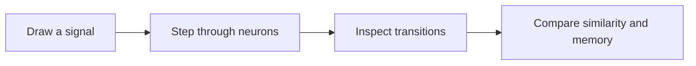

# Bombom

**A visual research lab for neuron graphs, memory, and signal propagation.**

[Quick start](#quick-start) · [First experiment](#first-experiment) · [Türkçe rehber](docs/README.tr.md)

Bombom makes experimental learning dynamics visible. Draw a signal, step through a directed neuron graph, and inspect how similarity and learned transition habits influence its path. Separate laboratories explore text representations, neuron families, and research snapshots.



Built with **TypeScript, React, and Three.js**, with a local Node.js research service. The interface and detailed research notes are in Turkish.

## Quick start

Requires **Node.js 24+** and **pnpm**.

```sh
git clone https://github.com/denizybd/bombom.git
cd bombom
pnpm install
pnpm dev
```

Open **http://127.0.0.1:5173** for the signal sandbox. On macOS, `BOMBOMU_BASLAT.command` also starts the local tools after dependencies are installed.

## First experiment

1. Draw a starting signal in the left editor.
2. Add a neuron with **Yeni nöron**, then edit its prototype with **Düzenle**.
3. Press **Tek adım** to follow one transition at a time.
4. Compare **K** (prototype similarity) with **H** (learned transition habits) and inspect the timeline.

The sandbox keeps its state in your browser. The local training service stores archives in the ignored `server-data/` directory.

## Explore the laboratories

| Laboratory | What to explore |
| --- | --- |
| Signal sandbox | Step-by-step signal transformations and transition evidence. |
| Text and neuron laboratories | Text representations, neuron synthesis, and learned families. |
| Training and thought traces | Research snapshots, candidate updates, and bounded signal trajectories. |
| Plastic region atlas and 3D universe | Inspect relation regions, neuron families, and graph structure. |

See the [Turkish guide](docs/README.tr.md) for routes, instructions, mathematical models, and validation boundaries.

## Research status

This is an experimental research prototype. Its visualizations and metrics do not establish general language understanding, consciousness, or competitive model quality. No trained model or local training archive is included.

Ollama can optionally supply training examples; **the basic sandbox does not require a language model**.

## Development checks

```sh
pnpm test
pnpm test:service
pnpm build
pnpm build:training-service
```

Start with the [mathematical model](docs/MATEMATIKSEL_MODEL.md) or [training architecture](docs/OTONOM_EGITIM_MODEL.md) for the underlying experiments.
